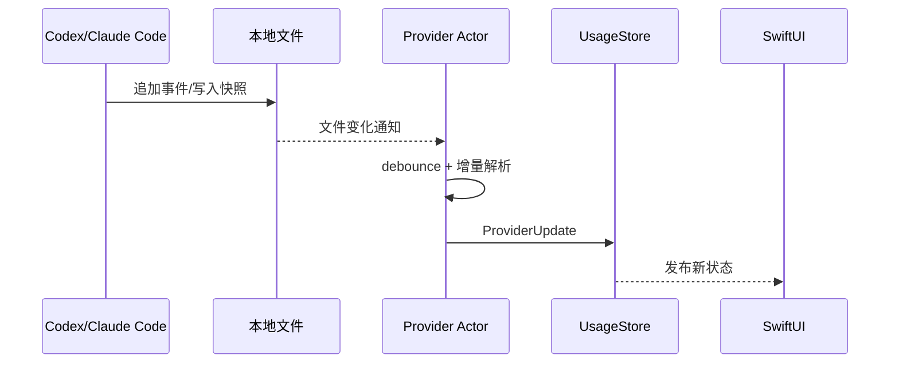

# 开发文档

## 0. 标准化开发流程

本项目采用 MacEverything 的项目更新约定：同步 About 说明、独立变更记录和索引，再通过统一命令验证。规则已写入根目录 [AGENTS.md](../AGENTS.md)，人工开发与编码代理均须遵循。

移植来源为本机 `MacEverything` 仓库的 `46b2472`（本次读取的 HEAD）：`AGENTS.md`、`Makefile`、`.github/workflows/pr-build.yml`、`MacEverything/App/AboutView.swift`、`docs/changelog/README.md` 与记录 148。这里保留流程要求，构建和测试适配为 Swift/Xcode；运行本项目无需安装或访问 MacEverything。

### 补充技能：standard-dev-flow

项目内同时保存了从 `ai_novel_agent`（来源 HEAD：`1df7a8bf6ff942b3146fc04e9b08296e459f2886`）原样复制的 [standard-dev-flow](../.agents/skills/standard-dev-flow/SKILL.md)。用户提及的 `standard-dev-workflow` 在源仓库中的实际目录名是 `standard-dev-flow`；本地保留原名，可用 `$standard-dev-flow` 调用。

完整目录包含四个文件：技能正文 `SKILL.md`、界面配置 `agents/openai.yaml`、[Issue 模板](../.agents/skills/standard-dev-flow/assets/issue.md) 和[模块设计模板](../.agents/skills/standard-dev-flow/assets/module-design.md)。功能/重构要求模块设计与真实复用调查，Bug 要求根因说明，维护/文档类型无需设计，调研类型以决策文档为产出；所有类型均包含模块拆解和验证计划。

本次仅放入完整技能包，未复制小说项目的应用代码、Git Hook、其他技能或环境分支配置。源包保留原始的类型分支映射；当前项目的 Git、About、变更日志和 `make verify` 规则继续以根目录 `AGENTS.md` 为准，导入本身不切换 Git 流程。若后续要将源技能整套设为强制工作流，应先明确其类型分支映射与现有 `codex/` 约定的适配，不能静默混用。

本次准备记录见 [导入技能的本地 Issue 草稿](issues/import-standard-dev-flow.md)。草稿未关联真实 Issue 号，未创建占位符分支，也未修改外部 Issue 系统。

### 一次变更的步骤

1. 查看 `git status`，阅读相关实现、调用方与测试，明确问题、修改范围和验收标准；保留已有工作区改动。需要新分支时使用 `codex/<description>`。
2. 完成最小可用修改，给行为变更补充相关回归验证。Provider 使用临时 fixture，避免真实日志、会话内容或凭证进入测试和 Git。
3. 同步 `SettingsView.swift` 的 About 版本说明，新增 `docs/changelog/NNN-description.md`，在其索引的“最新更新”和“变更索引”中添加链接，并更新根目录 `CHANGELOG.md` 的 `Unreleased` 摘要。
4. 修改 `project.yml` 后执行 `make generate`，一并提交生成的 Xcode 工程与共享 scheme。测试 scheme 固定中文参数，仅作用于测试进程，避免本机语言偏好影响断言。
5. 运行 `make verify`。它检查本次变更的 About/日志配套修改、运行流程检查器的自测与全部 Swift 测试，再核对构建出的 App 版本。不依赖手工修改 `.xctestrun` 或用户偏好。
6. 查看最终 diff，确认 About、日志、文档和实际行为一致。交付说明列出已验证项与未验证范围；本地通过不等于 CI、UI、真实额度采集或发布验证已通过。

单条变更记录须写明日期、问题与结果、实现范围、执行的验证及结果、未验证项、是否变更版本号。编号递增；发生分支编号冲突时，合并前分配新编号并修正索引链接。已有历史发布摘要保留在根目录 `CHANGELOG.md`，不批量重写成新的逐次记录。

### 统一命令

| 命令 | 用途 |
| --- | --- |
| `make generate` | 从 `project.yml` 重新生成工程（需要 XcodeGen） |
| `make build` / `make app` | 构建当前机器架构的 Debug 应用 |
| `make test` / `make test-all` | 运行全部 Swift 单元测试 |
| `make check-process` | 检查未提交变更的 About/变更记录配套更新及索引链接 |
| `make check-process BASE_REF=<ref>` | 按 `<ref>...HEAD` 检查 PR 变更；需能访问该 Git 基准 |
| `make release-check` | 检查当前配置的版本与 About 版本来源 |
| `make verify` | 流程检查、单元测试、构建后版本检查 |
| `make dmg` | 调用原有 Release DMG 打包脚本，不发布或替换已安装应用 |

可覆盖 `BUILD_DIR`、`CONFIGURATION` 和 `ARCH`，例如 `make build ARCH=x86_64` 做 Intel 交叉构建。只有匹配的宿主机器才能完成该架构的原生运行验证。

`.github/workflows/pr-check.yml` 在 PR 中分别使用 Apple Silicon 和 Intel runner 执行 `make verify`，包括与 PR 基准的流程检查；任务限时 30 分钟，新提交会取消同一 PR 的旧任务。Tag 版本检查已整合到 `.github/workflows/release.yml`，保留构建前后门禁并自动打包。CI 工作流须推送到 GitHub 后才能验证运行结果。

开发分支保留当前版本号。按用户授权，合入 `main` 后由 `auto-release.yml` 自动递增补丁版本与构建号，更新版本、生成工程、README、根目录摘要和编号发布记录，原子推送机器人版本提交及 Tag，然后调用 Release。About 从 Info.plist 读取版本，无需机器人反复修改 UI 源码。此自动流程不替换已安装应用。

## 1. 技术选择

构建需要 Xcode 26+（包含 macOS 26 SDK）；最低运行版本仍为 macOS 13。原生 `glassEffect` 仅在 macOS 26+ 调用，旧系统使用材质回退。

| 项目 | 选择 | 原因 |
| --- | --- | --- |
| UI | SwiftUI | 原生菜单栏与设置窗口，较低常驻开销 |
| 菜单栏 | `MenuBarExtra` + `.window` | 适合信息密度较高的弹窗 |
| 最低系统 | macOS 13 | `MenuBarExtra` 的可用基线 |
| 并发 | Swift Concurrency | actor 隔离文件状态，AsyncStream 推送更新 |
| 解析 | Foundation `JSONDecoder` | 无额外运行时依赖，支持忽略未知字段 |
| 缓存 | JSON/plist，后续可迁移 SwiftData | MVP 数据量小且便于诊断 |
| 主题 | `AppStorage` + `preferredColorScheme` | 三态切换简单、即时且可持久化 |
| 测试 | Swift Testing 或 XCTest | fixture 驱动，不读取真实用户数据 |

参考资料：

- [Apple MenuBarExtra](https://developer.apple.com/documentation/swiftui/menubarextra)
- [Claude Code status line](https://code.claude.com/docs/en/statusline)
- [Claude Code usage monitoring](https://code.claude.com/docs/en/monitoring-usage)
- [OpenAI Codex plan usage](https://help.openai.com/en/articles/11369540-using-codex-with-your-chatgpt-plan)

## 2. 工程初始化

在 Xcode 中创建：

```text
Template: App
Product Name: AIUsage
Interface: SwiftUI
Language: Swift
Testing System: Swift Testing
Minimum Deployment: macOS 13.0
```

推荐 targets：

```text
AIUsage                  主菜单栏应用
AIUsageCore              可选 Swift Package，领域模型和 provider
AIUsageTests             单元测试
AIUsageUITests           菜单栏和设置页烟雾测试
claude-usage-collector   小型命令行 helper
```

主应用 `Info.plist` 设置 `LSUIElement = YES`，避免显示 Dock 图标。若同时提供普通设置窗口，需验证菜单栏 scene 被用户移除时的生命周期行为。

## 3. 实现顺序

### 第一步：菜单栏骨架

创建 `MenuBarExtra`、`AppState` 和静态 provider 卡片。先使用 fixture 数据完成浅色、深色、空状态和错误状态，再连接真实文件。

```swift
@main
struct AIUsageApp: App {
    @StateObject private var state = AppState()
    @AppStorage("appearance.theme") private var theme = AppTheme.system.rawValue

    private var selectedTheme: AppTheme {
        AppTheme(rawValue: theme) ?? .system
    }

    var body: some Scene {
        MenuBarExtra {
            MenuBarView()
                .environmentObject(state)
                .frame(width: 360)
                .preferredColorScheme(selectedTheme.colorScheme)
        } label: {
            Label(state.menuBarText, systemImage: "gauge.with.dots.needle.67percent")
        }
        .menuBarExtraStyle(.window)

        Settings {
            SettingsView()
                .environmentObject(state)
                .preferredColorScheme(selectedTheme.colorScheme)
        }
    }
}
```

主题值定义为稳定字符串：

```swift
enum AppTheme: String, CaseIterable, Identifiable {
    case system
    case light
    case dark

    var id: Self { self }

    var title: LocalizedStringKey {
        switch self {
        case .system: "跟随系统"
        case .light: "浅色"
        case .dark: "深色"
        }
    }

    var colorScheme: ColorScheme? {
        switch self {
        case .system: nil
        case .light: .light
        case .dark: .dark
        }
    }
}
```

### 第二步：Codex provider

1. 检测 `codex` 可执行文件与数据目录。
2. 枚举 sessions 与 archived_sessions 中的 JSONL。
3. 从文件尾部寻找最新 `token_count`，建立初始额度快照。
4. 扫描历史事件并按会话累计差值生成每日 token 汇总。
5. 保存每个文件的读取偏移和会话累计值。
6. 定时刷新时只读取文件追加内容；生产环境注入官方 App Server 额度 reader，最多等待 8 秒，失败返回本地日志额度。
7. 通过 PATH 和常用 Homebrew / ~/.local/bin 路径查找已安装 CLI，只执行初始化和 account/rateLimits/read；用假 stdio 可执行文件验证握手、bucket、超时和错误，不读取测试机器的真实登录。
8. 打开菜单面板立即刷新；真实读取验证只输出额度字段，禁止将用户原始日志或 RPC 响应提交到仓库。

建议采用宽容解码：

```swift
struct CodexEnvelope: Decodable {
    let type: String
    let timestamp: Date?
    let payload: Payload?

    struct Payload: Decodable {
        let type: String?
        let info: TokenInfo?
        let rateLimits: RateLimits?

        enum CodingKeys: String, CodingKey {
            case type, info
            case rateLimits = "rate_limits"
        }
    }
}
```

禁止将整行 JSON 解码成通用字典后写入缓存，这会增加意外保存会话正文的风险。

### 第三步：Claude collector

Claude Code 的 status line 是最稳定的实时数据出口。helper 从 stdin 接收 JSON，仅输出白名单字段到快照文件。

原子写入流程：

```text
写入 claude-snapshot.json.tmp
fsync/关闭文件
rename 为 claude-snapshot.json
```

集成安装器需要：

1. 读取 `~/.claude/settings.json`。
2. 如果存在 `statusLine`，把原设置序列化保存到应用自己的配置中。
3. 安装包装命令，而不是直接丢弃原命令。
4. 更新设置时保留所有未知键。
5. 卸载时只在当前值仍属于本应用时恢复备份，避免覆盖用户后续修改。

collector 执行必须足够快，目标低于 50 ms，且失败时不得影响 Claude Code 原 status line。

### 第四步：聚合与持久化

每日统计键：

```text
local-calendar-day + provider + model(optional)
```

事件时间以 UTC `Date` 存储，分桶时使用用户当前日历和时区。如果系统时区改变，保留已落盘日桶，不静默重算历史。

额度快照只保存最新有效值和观察时间；历史图可按固定间隔采样，避免每次事件产生大量重复点。

### 第五步：设置与启动项

- 使用 ServiceManagement 的 `SMAppService.mainApp` 管理开机启动。
- 菜单栏显示模式存入 `AppStorage`。
- 主题选择使用分段或单选 `Picker`，值为“跟随系统 / 浅色 / 深色”，默认 `system`。
- 将同一个 `preferredColorScheme` 同时应用到菜单弹窗、设置页和历史窗口。
- 菜单栏图标使用 template rendering，继续跟随 macOS 菜单栏，不受应用强制主题影响。
- 数据目录变更必须重新检测，并清空相应 offset 索引而不是其他 provider 数据。

## 4. 刷新策略



- 文件事件 debounce：约 300 ms。
- 兜底检查：默认 60 秒，可配置但不低于 10 秒。
- 点击刷新：立即检查修改时间，不强制全量扫描。
- 首次全量扫描显示进度并允许取消。

## 5. UI 实现规则

- 弹窗建议宽度 340–380 pt。
- 常态不使用滚动；错误详情和历史进入独立窗口。
- 百分比文字与进度条同时存在，不能只用颜色表达状态。
- 用量颜色：正常使用 provider 品牌提示色；超过用户阈值后统一切换为系统橙/红警示色。
- 重置时间在小于 24 小时时显示倒计时，否则显示日期和时间。
- `0%` 与“无数据”必须有不同呈现。
- 浅色模式使用系统浅色材质；深色模式避免大面积纯黑，使用系统窗口背景与分层卡片材质。
- 跟随系统模式不得缓存启动时的 `colorScheme`，必须允许 SwiftUI 响应运行中的系统切换。
- VoiceOver 文案示例：“Codex，五小时额度已使用百分之六十二，两小时十四分钟后重置”。

## 6. 测试计划

### 单元测试

- Codex `last_token_usage` 与 `total_token_usage` 解码。
- primary/secondary 窗口字段缺失与乱序。
- Claude five_hour/seven_day 单独缺失。
- Unix 时间转换和重置倒计时。
- 同一累计事件重复读取不会重复计数。
- 会话累计归零、文件截断和轮转。
- 文件最后一行尚未写完。
- 损坏 JSON 与未知事件类型。
- 跨午夜和夏令时边界。

### 集成测试

- 在临时目录逐行追加 fixture，确认更新流。
- 安装 Claude wrapper 后保留原 status line 输出。
- 卸载 wrapper 后恢复原设置。
- CLI 不存在或目录不可读时状态正确。

### UI 与无障碍检查

- 菜单栏和卡片主圆环只使用明确的 300 分钟窗口，覆盖 0%、部分、100%、缺失、过期、仅周额度与窗口乱序。
- 背景透明度 0–100%、偏好保存、浅/深/跟随系统，以及“减少透明度”和“减少动态效果”。
- 模板圆环在浅深菜单栏均可辨认；悬停与 VoiceOver 保留准确百分比。
- 原生组件预览导出需要本机可用 GPU，默认不纳入 CI 执行。在本机运行 `TEST_RUNNER_AI_USAGE_RENDER_PREVIEWS=1 make test`，测试进程会收到 `AI_USAGE_RENDER_PREVIEWS=1` 并在 `.build/ui-previews/` 输出浅深色示例布局。逻辑与菜单圆环图像测试始终运行；离屏预览不验证桌面背后的玻璃采样或真实滑块交互。
- 浅色、深色和增加对比度。
- 文字大小与中英文混排。
- VoiceOver 顺序。
- 低宽度菜单栏下的标题降级策略。
- 三种主题即时切换、偏好持久化和系统外观动态变化。
- 浅色与深色模式下的文字、进度轨道、分隔线和焦点环对比度。

### MiniMax 缓存兼容回归

MiniMax 只读取 Desktop 额度缓存。`MiniMaxCacheTests` 使用合成 Simple Cache v5 文件和独立编码器生成的 Brotli 样本，验证边界、CRC、解压上限、百分比字符串、无限制、旧字段兼容、同文件更新、写入中保留与错误响应。fixture 不含用户数据，测试不依赖 Homebrew 解压命令。协议参考 [Chromium 缓存格式](https://chromium.googlesource.com/chromium/src/+/refs/heads/main/net/disk_cache/simple/simple_entry_format.h) 与 [Apple COMPRESSION_BROTLI](https://developer.apple.com/documentation/compression/compression_brotli)。真实验证只输出额度白名单字段；手动刷新依赖 MiniMax Code 写入新缓存，不能使用过期窗口推算新值。

## 7. 诊断与日志

使用 `Logger` 分类：

```text
app.lifecycle
provider.codex
provider.claude
storage.aggregate
integration.claude
```

日志允许包含版本、事件类型、文件大小和错误码；禁止包含原始行、项目路径、session ID、用户名、提示词和工具参数。

## 8. 构建与发布

### 8.1 无 Apple Team ID 的直接分发

当前阶段可运行以下脚本生成通用架构 Release DMG：

```bash
./scripts/build-direct-release.sh
```

main 合入后会自动同步 `project.yml` 的 `MARKETING_VERSION`、`CURRENT_PROJECT_VERSION`、
生成的 Xcode 工程、README 和发布日志，再创建版本 Tag。日常开发不要手动升版；可随时运行版本来源检查：

```bash
make release-check
```

`.github/workflows/auto-release.yml` 监听 main 的 push（包括 PR 合并），串行执行版本准备。
版本脚本要求干净工作区，以当前配置和已有正式版本 Tag 的最大值递增补丁号，构建号加一；
不会将预发布 Tag 当作正式版本。Unreleased 摘要归档为新版本，并生成下一条编号发布记录。
如果 HEAD 已带有匹配配置的版本 Tag，则复用该 Tag，重跑不会额外升版。

版本提交与 Tag 通过 `git push --atomic` 一次推送，拒绝非快进与 Tag 冲突，不强制覆盖。
若准备期间 main 又有新提交导致失败，可重跑 Automatic release，基于最新 main 重新准备。
使用内置 GITHUB_TOKEN 的推送不会触发普通 push 工作流，因此通过 `workflow_call` 显式调用 Release，
无需额外 PAT，也不依赖新增 push 事件。版本准备与发布任务分别授予所需的 `contents: write`；
若分支保护阻止机器人提交，流程会明确失败，不修改保护配置。
参考 [GitHub 事件触发说明](https://docs.github.com/en/actions/how-tos/write-workflows/choose-when-workflows-run/trigger-a-workflow)
和[复用工作流](https://docs.github.com/en/actions/how-tos/reuse-automations/reuse-workflows)。

自动调用、Tag 推送或手动重建时，`.github/workflows/release.yml` 会再次检查 Tag、项目配置和“关于”页的版本来源，
运行 `make verify`，再调用原有打包脚本构建 Release，检查 App 的 `CFBundleShortVersionString`、
双架构及临时签名。原来的 `verify-release-tag.yml` 已合并到该流程，避免重复构建。
任一版本不一致或测试失败时，依赖构建结果的发布任务不会执行。

也可在 GitHub「Actions → Release → Run workflow」中填写已有的 `vX.Y.Z` 或 `X.Y.Z` Tag。
输入先校验格式，再以 `refs/tags/<tag>` 检出，防止将同名分支或默认分支当作发布来源。
该 Tag 的源码需包含当前 Makefile、版本检查和打包入口。工作流在 `macos-15` 上明确选择 Xcode 26，
构建任务仅有仓库读取权限；只有成功构建后的发布任务获得 `contents: write`。

构建产物上传为 Actions Artifact `AI-Usage-<tag>-universal`。发布任务下载并复核 SHA-256 后，
为对应 Tag 创建或更新 GitHub Release，并附上 DMG 与 `.dmg.sha256`；相同 Tag 重跑会更新附件。
流程使用内置 `GITHUB_TOKEN`，不需要额外 PAT。发布说明注明临时签名、未公证；远程运行结果需在实际推送 Tag 后确认。

直接发布脚本也会执行同样的发布前与构建后检查，然后重新生成 Xcode 工程、
构建 Release、添加临时代码签名、创建带“应用程序”快捷方式的 DMG，并生成
SHA-256 校验文件。产物位于 `dist/`。

脚本可接收可选版本参数，例如 `./scripts/build-direct-release.sh v1.2.2`；
CI 显式传入触发 Tag，避免同一提交上多个 Tag 导致 `git describe` 选错版本。
通用架构通过 `ARCHS="arm64 x86_64"` 和 `ONLY_ACTIVE_ARCH=NO` 固定，并在打包前用 `lipo` 校验。

此方式不需要 Apple Team ID，但没有 Developer ID 签名和 Apple 公证。首次启动时，用户需要在 Finder 中右键应用并选择“打开”，或在“系统设置 → 隐私与安全性”中选择“仍要打开”。它适合当前直接分发、内部测试和早期版本，不应描述为“Apple 已验证”或“已公证”。

### 8.2 配置 Apple Team ID 后

Developer ID 发布流程：

1. Release 配置开启 Hardened Runtime。
2. 使用 Developer ID Application 签名。
3. Archive 后提交 Apple Notary Service。
4. 对公证成功的应用执行 stapling。
5. 打包 DMG 或 ZIP，并验证一台干净机器上的 Gatekeeper 行为。
6. 发布 SHA-256 校验值和隐私说明。

若启用 Sparkle，需要单独保护更新签名私钥，并通过 HTTPS 发布 appcast。

## 9. 开发完成检查表

- [ ] About 说明、编号变更记录、日志索引和 `CHANGELOG.md` 摘要与实际改动一致。
- [ ] `make verify` 通过，未验证项在变更记录和交付说明中明确列出。
- [ ] 若为发布：Tag、`MARKETING_VERSION`、生成工程与“关于”页版本完全一致，`CURRENT_PROJECT_VERSION` 已递增。
- [ ] 无真实用户日志进入 git。
- [ ] fixture 已去除路径、会话 ID 和内容字段。
- [ ] 所有 provider 均支持无数据和格式错误状态。
- [ ] 额度时间使用本地化格式。
- [ ] 三态主题切换、重启持久化和跟随系统行为通过测试。
- [ ] Claude 原 status line 可恢复。
- [ ] 重启和重复扫描不会重复计数。
- [ ] 若涉及资源使用：记录空闲 CPU、内存和文件句柄检查范围，24 小时检查未执行时明确说明。
- [ ] 若为发布：完成适用的签名、公证和干净机器安装检查，未公证包如实标注。
