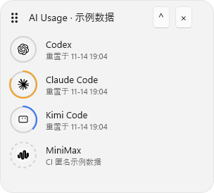

# AI Usage for Windows · 首版预览

[返回项目首页](../../README.md) · [设计](../design/issue-24-windows-rings.md) · [Issue #24](https://github.com/YuSec2021/ai-usage-display/issues/24)

Windows 11 x64 原生应用，采用 C#、.NET 10 LTS 与 WinUI 3。每个模型使用 Logo 和外圈表示 **5 小时已用额度**；托盘与浮窗不显示百分比文字。零用量是空轨道，未知是虚线，过期窗口不会继续作为当前额度；周额度与 Token 不替代主圆环。

## 原生浮窗效果

以下为 Windows CI 中渲染的真实 WinUI 界面，使用匿名样本；生产模式从实际数据源读取。




## 下载与运行

在 [Windows Actions](https://github.com/YuSec2021/ai-usage-display/actions/workflows/windows.yml) 中选择对应 PR 或 main 的成功任务，下载 `AI-Usage-Windows-x64-preview` Artifact。解压其中的预览 ZIP，保留整个目录并运行 `AIUsage.Windows.exe`；同包 `.sha256` 可验证 ZIP。

产物包含 .NET 与 Windows App SDK 自包含运行文件，不需要先安装 .NET SDK。首版未做 Authenticode 签名，不是 Microsoft Store 安装包；Windows 可能显示未知发布者提示。不要把 exe 单独移出目录。开发工具与测试模式均不替换现有应用或启动项。

首次打开显示主窗口和浮窗。主窗口有用量、7 天历史与设置；最小化保留任务栏按钮，关闭主窗口收起到托盘。浮窗可拖动把手、靠边吸附、置顶、展开/收起和隐藏；托盘右键可恢复浮窗、刷新或退出。再次启动会恢复已有主窗口，不另开采集进程。托盘最终排列和折叠由 Windows 设置决定。

## 数据源

| 模型 | 首版读取方式 | 限制 |
| --- | --- | --- |
| Codex | PATH / npm 用户目录的 Codex CLI，通过官方只读 app-server 请求当前额度；本地 sessions / archived_sessions 用于 Token 与额度回退 | 不读取 auth.json，不创建对话；8 秒超时，接口失败回退本地数据；CLI 缺失显示等待状态 |
| Claude Code | 设置中安装 status line 集成，完成一次对话后写入额度；projects 下本地 JSONL 用于 Token | 安装备份原 statusLine，保留原命令输出；卸载仅在命令仍属于本集成时恢复，保留其他设置；原命令使用 Git Bash，最多等待 5 秒 |
| Kimi Code | 本地 sessions 下 wire.jsonl 的 usage.record / StatusUpdate；主动配置 Key 后请求官方 usages API | Key 保存到当前用户 Windows Credential Manager；支持 KIMI_API_KEY 环境变量，环境变量优先，移除保存 Key 不会清除环境变量 |
| MiniMax | 显示暂不支持 | Windows Desktop 缓存位置和格式尚未验证，不伪造额度或使用其他模型推算 |

默认读取当前用户 `.codex`、`.claude`、`.kimi-code`（兼容 `.kimi`）。支持 CODEX_HOME、CLAUDE_CONFIG_DIR、KIMI_CODE_HOME。首版只接 Windows 本机，尚未接入 WSL、Claude Desktop 或 Kimi Desktop 日志。初次扫描每个日志最多读取末尾 16 MiB，单条最大 1 MiB；目录最多选最近 1600 个文件，跳过七天前未修改的历史文件（保留最新文件供额度回退）。每轮最多新增读取 64 MiB，余下内容下轮继续。界面会标记有界扫描的 Token 历史可能不完整，统计不代表完整账单。

仅持久化偏好、聚合状态和提取后的额度字段。不会把提示词、回答、工具参数、RPC 原文或 Key 写入设置文件/日志。Claude 的原 statusLine 备份保存在本地应用数据中，仅用于恢复。配置发生变化时拒绝旧刷新结果；文件读取失败保留标记过期的旧样本。

## 开发与验证

安装 .NET 10 SDK。跨平台核心不引用 WinUI，可在 macOS 或 Windows 运行：

```bash
make windows-test
```

Windows PowerShell 构建原生应用：

```powershell
dotnet test windows/AIUsage.Core.Tests/AIUsage.Core.Tests.csproj -c Release
dotnet publish windows/AIUsage.Windows/AIUsage.Windows.csproj -c Release -r win-x64 --self-contained true -o dist/windows-x64 -p:Platform=x64
```

项目通过 `windows/Directory.Build.props` 从根目录 project.yml 读取版本与构建号，不手动升版。WinUI 构建需 Windows；在 macOS 通过核心测试不代表 Windows GUI 通过。GitHub Windows workflow 编译、运行核心回归、生成 ZIP 与 SHA-256，再从 ZIP 解压到含空格路径，验证 collector 模式并启动带匿名样本的原生窗口，导出紧凑/展开浮窗、主窗口、历史和设置 PNG。`windows-verification` Artifact 包含测试和烟雾结果；示例数据仅在显式 smoke 模式使用，生产默认从不显示模拟额度。

```powershell
./windows/scripts/smoke.ps1 -Executable dist/windows-x64/AIUsage.Windows.exe -Output "$env:TEMP/ai-usage-smoke"
```

实际执行结果及未验证范围见 [024 变更记录](../changelog/024-windows-rings.md)；Windows 用户机器上的登录、真实额度刷新、多显示器/DPI、Explorer 重启和交互体验需单独验收，不能由编译结果替代。
